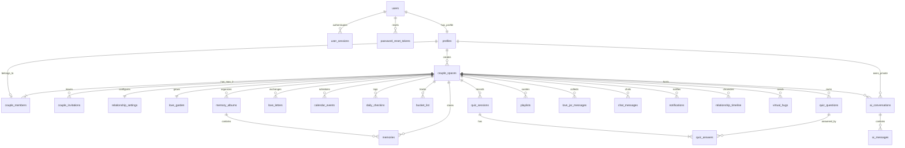

# Entity Relationship Diagram (ERD) — Our Little World (MySQL / phpMyAdmin)

Diagram di bawah menggambarkan relasi seluruh **26 tabel** pada database MySQL/MariaDB `our_little_world` di XAMPP & phpMyAdmin.

## Ringkasan Integritas Relasional

- **Engine & Charset**: Seluruh 26 tabel menggunakan `ENGINE=InnoDB` dan `utf8mb4_unicode_ci` untuk dukungan transaksi atomik, Foreign Key `ON DELETE CASCADE/SET NULL`, serta seluruh karakter emoji.
- **Isolasi Multi-Pasangan**: Setiap tabel fitur menyimpan kolom `couple_id` dan setiap Server Action/API hanya memproses `couple_id` milik sesi yang login.
- **Maksimal 2 Anggota**: `couple_members` memiliki `UNIQUE(user_id)` dan transaksi `FOR UPDATE` saat klaim kode undangan guna memastikan maksimal 2 akun per Couple Space.
